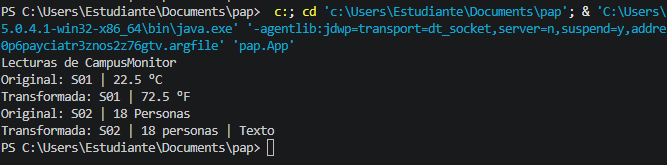

1. Implementacon realizada

En un párrafo breve, explica qué representa R y por qué transformar es genérico aunque runTransformaciones no lo sea. Indica qué agregaste en Lectura y App.

La R representa como que el tipo de dato que tendrá un nuevo valor despues de hacer la transformación, por eso transformar es genérico: ya que permite convertir un valor a otro, mientras que runTransformaciones no lo es porque funciona con tipos específicos, como Double, Integer y String. En la clase Lectura agregué el método genérico transformar, que utiliza Function<T, R> este sirve para convertir el valor y devuelve una nueva lectura con la unidad actualizada. En la clase App agregué el metodo runTransformaciones y dos ejemplos uno para convertir la temperatura de Celsius a Fahrenheit y la segunda para cambiar la ocupación numérica a texto.

2. Ejecucion correctas:

